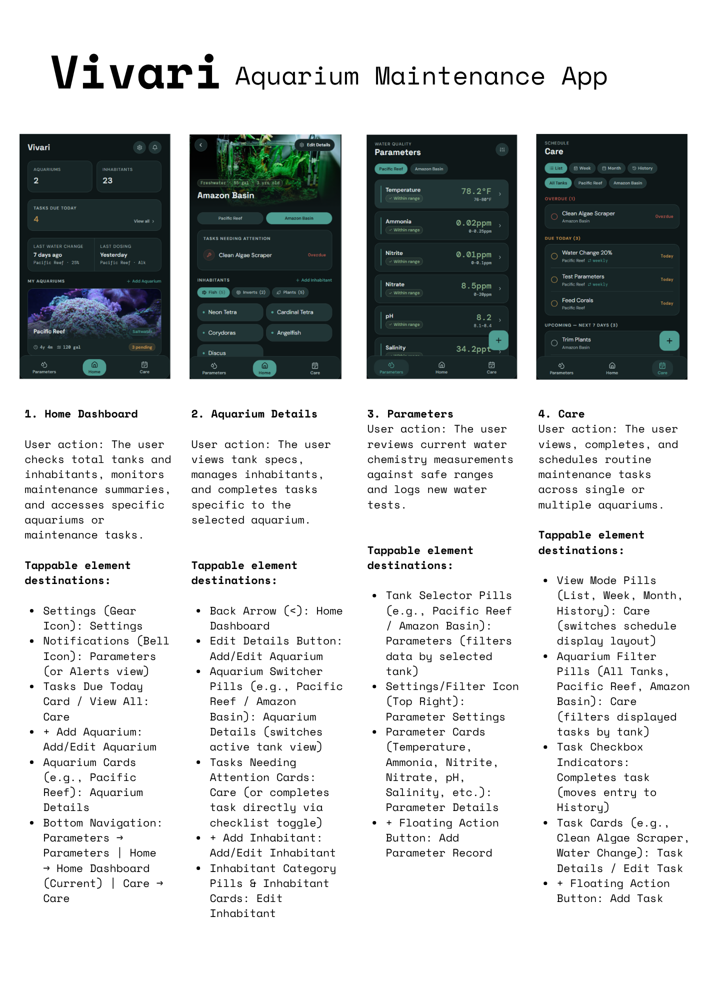

# Mockup and wireframes

This document brings together the submitted visual mockup, the wireframe
document, and the intended screen flow for Vivari. The wireframes capture the
early structure and navigation; the mockup shows the visual direction for the
main aquarium-care screens.

## Mockup

[Open the full mockup image](assets/PROJECT/mockup.png).



The mockup presents four primary views:

1. **Home dashboard** — aquarium and inhabitant totals, tasks due today, recent
   care activity, and aquarium cards.
2. **Aquarium details** — tank information, an aquarium switcher, tasks needing
   attention, and inhabitant categories and entries.
3. **Parameters** — aquarium selection and water-reading cards, including
   current values, recommended ranges, and status.
4. **Care** — list, week, month, and history views for tasks, with aquarium
   filters and task status.

The mockup is a visual reference. Some details and interactions have evolved
in the current app; the screen descriptions below reflect the implemented
navigation and features.

## Wireframes

[Open or download the wireframes PDF](assets/PROJECT/Wireframes.pdf).

The wireframes establish the main journey: start at Home, choose or add an
aquarium, then use the bottom navigation to move between Parameters, Home, and
Care. Aquarium-specific actions open from the selected aquarium; parameter
settings and care-entry forms are reached from their respective sections.

## Final screen flow

```text
App launch
└── Main shell opens on Home
    ├── Parameters tab
    │   ├── Select aquarium (when aquariums exist)
    │   ├── Select a parameter ──> Parameter details and chart ──> Back to Parameters
    │   ├── Tune icon ──> Parameter Settings sheet ──> Apply or dismiss ──> Parameters
    │   └── Add button ──> Log Parameters form ──> Save or cancel ──> Parameters
    ├── Home tab
    │   ├── Add Aquarium ──> Add Aquarium form ──> Save or cancel ──> Home
    │   ├── Select aquarium card ──> Aquarium Details
    │   │   ├── Edit Details ──> Edit Aquarium form ──> Save or cancel ──> Aquarium Details
    │   │   ├── Delete aquarium ──> Confirmation dialog ──> Home
    │   │   ├── Add Inhabitant ──> Add Inhabitant form ──> Save or cancel ──> Aquarium Details
    │   │   └── Edit inhabitant ──> Quantity dialog ──> Save or dismiss ──> Aquarium Details
    │   └── Open aquarium tasks ──> Care tab, List view filtered to that aquarium
    └── Care tab
        ├── Select List, Week, Month, or History view
        ├── Filter by aquarium (or show all tanks)
        ├── Complete/uncomplete task ──> Update task completion
        └── Add button ──> Add options sheet
            ├── Log activity ──> Log Activity form ──> Save or cancel ──> Care
            └── Add task ──> Add Task form ──> Save or cancel ──> Care

Bottom navigation switches between Parameters, Home, and Care. Each tab keeps
its own navigation stack while switching tabs; Back from a pushed form or
detail returns to its originating tab.
```

## Screens and actions

The descriptions below cover each page and each interactive sheet, dialog, or
in-place view change currently available in the app.

### Main shell and bottom navigation

The app opens on **Home**. The bottom navigation switches among **Parameters**,
**Home**, and **Care**. Each tab has its own navigation stack, so opening a
detail or form and switching tabs does not replace the other tab's stack.

### Home dashboard

Displays aquarium and inhabitant totals, tasks due today, last water-change and
dosing activity, and aquarium cards.

- **Add Aquarium** opens the Add Aquarium form.
- Selecting an aquarium card opens Aquarium Details.
- Selecting an aquarium's pending-task count opens Care in List view filtered
  to that aquarium.
- Selecting the due-today summary or **View All** switches to Care.

### Aquarium Details

Opened by selecting an aquarium card on Home. Shows tank information, tasks
needing attention, inhabitant category totals, and inhabitants.

- The category chips filter the visible inhabitants.
- **Add Inhabitant** opens the Add Inhabitant catalog.
- Selecting an inhabitant opens the Edit Inhabitant dialog to change its
  quantity or remove it.
- **Edit Details** opens the Edit Aquarium form.
- Back returns to Home.

### Add Aquarium and Edit Aquarium

The same form is used to create or update an aquarium. It collects the name,
freshwater/saltwater type, volume and unit, optional photo, and creation date.
The creation-date control opens a calendar date picker; the photo control opens
the device photo picker. **Create** or **Save** returns to Home or Aquarium
Details with the result. In edit mode, **Delete Aquarium** opens a confirmation
dialog; confirming deletes the aquarium and returns to Home, while cancelling
keeps the form open.

### Add Inhabitant catalog

Opened from Aquarium Details. Search filters the local catalog by names and
keywords; category chips filter between All, Fish, Inverts, Plants, and (for
saltwater tanks) Corals. Selecting catalog cards toggles multiple selections.
**Add to Aquarium** returns to Aquarium Details with the selected entries;
Cancel returns without adding them.

### Edit Inhabitant dialog

Opened by selecting an inhabitant card in Aquarium Details. The plus/minus
controls adjust quantity; **Save Changes** applies it. The remove action removes
the inhabitant, and dismissing the dialog leaves the quantity unchanged.

### Parameters overview

Shows enabled water-quality parameter cards for the selected aquarium. Aquarium
chips change the tank whose values and ranges are shown. Selecting a parameter
opens Parameter Details. The tune/settings button opens Parameter Settings;
the add button opens Add Measurements.

### Parameter Settings sheet

Opened from the Parameters overview. Aquarium chips select which tank's
recommended ranges are being edited. Each parameter can be enabled or disabled,
and drag handles reorder the list. The range-settings control on a parameter
opens the Edit Parameter Range dialog. **Done** applies the settings and
returns to Parameters; the close button dismisses the sheet without applying
the pending changes.

### Edit Parameter Range dialog

Opened from a parameter in Parameter Settings. With no aquarium selected, the
dialog selects Freshwater or Saltwater and edits that type's minimum and
maximum. With an aquarium selected, it edits that tank's range and can apply
the range to all tanks of the same water type. **Save** accepts a valid range;
Cancel dismisses the dialog without changing it.

### Add Measurements

Opened from Parameters for the currently selected aquarium. The user selects an
enabled parameter, enters its value, and can set a measurement date and time
using calendar and time pickers. **Now** resets both to the current date and
time. **Add Measurement** saves the reading and returns to Parameters; the
close button cancels.

### Parameter Details

Opened by selecting a parameter card. Shows the latest value, status, average,
recommended range, and chart for that parameter and aquarium. **Week** and
**Month** chips switch the chart's time window; Back returns to Parameters.

### Care

The Care tab offers four in-place views: **List**, **Week**, **Month**, and
**History**. The aquarium filter switches between All Tanks and an individual
tank. Task checkboxes mark scheduled tasks complete or incomplete; History
shows completed tasks and logged care activity. Opening Care from an aquarium
task count selects that tank and resets the view to List.

- The add button opens the Care Add Options sheet.
- **Add task** opens the Add Task form.
- **Log activity** opens the Log Activity form.

### Care Add Options sheet

Opened by the Care add button. Choose **Add task** to plan future care or
**Log activity** to record completed care. Dismissing the sheet returns to Care
without opening a form.

### Add Task

Opened from Care Add Options. Select a task category, enter a title, and choose
one or more aquariums in the Aquarium Selection sheet. The recurring-task
switch reveals schedule controls: Basic recurrence by days/weeks/months,
Custom Interval, Specific Weekdays, or Specific Month Days. Date and time
controls open calendar and time pickers. **Create Task** saves and returns to
Care; Back cancels.

### Log Activity

Opened from Care Add Options. Select a date with the calendar picker and
aquariums with the Aquarium Selection sheet. Choose one or more predefined
activities, or select Custom activity to enter a name and category. Saved
activity templates can be applied; **Create template** enables saving the
current activity as a reusable template. Optional amount, unit, and note fields
capture additional details. Selecting the unit opens the Unit Picker sheet.
**Save activity** records the activity and returns to Care; Close cancels.

### Aquarium Selection sheet

Opened from Add Task or Log Activity. Check or uncheck aquariums in the list,
then select **Done** to return the selected tanks to the form. Dismissing the
sheet leaves the form's previous selection unchanged.

### Unit Picker sheet

Opened from the Unit field in Log Activity. Choose a listed volume, mass,
count, or measure unit, or enter a custom unit. **Use unit** returns the
selection to Log Activity; dismissing the sheet keeps the prior unit.
